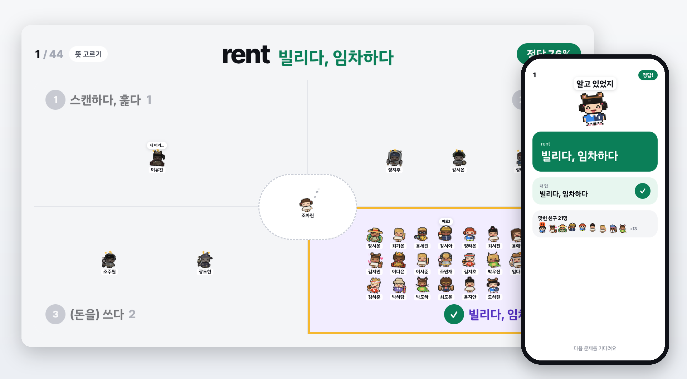
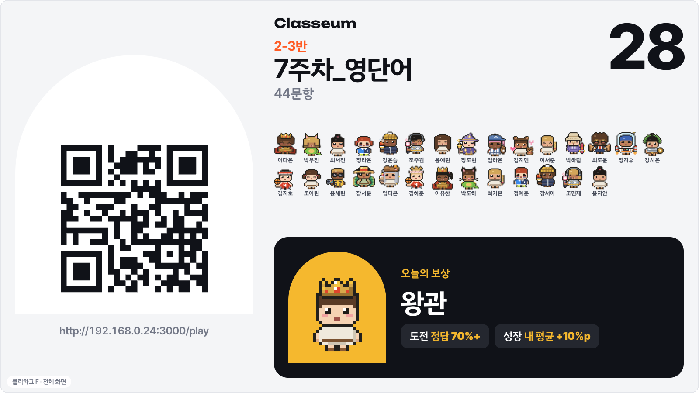
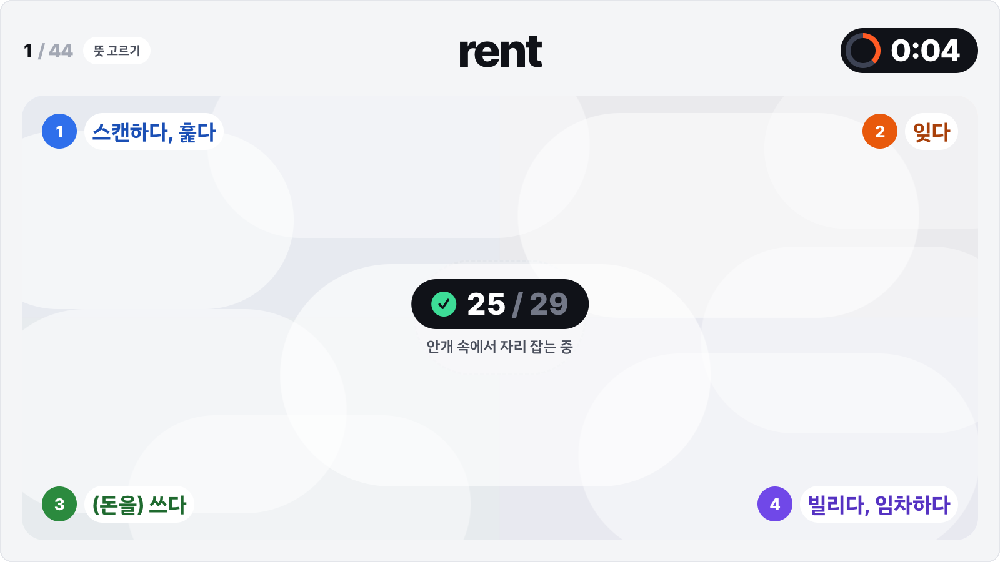
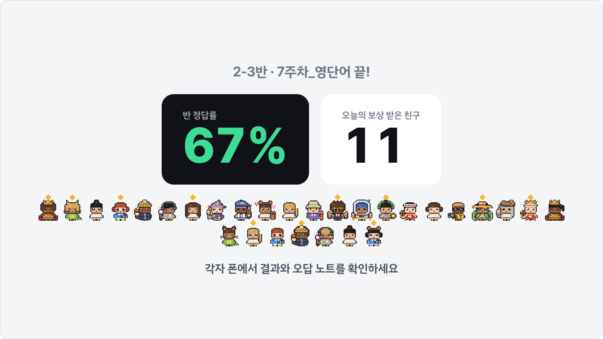
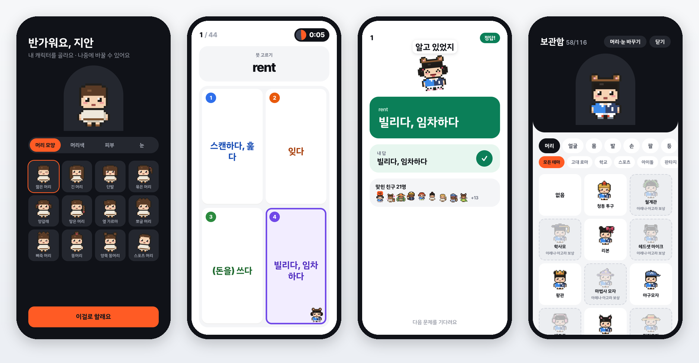
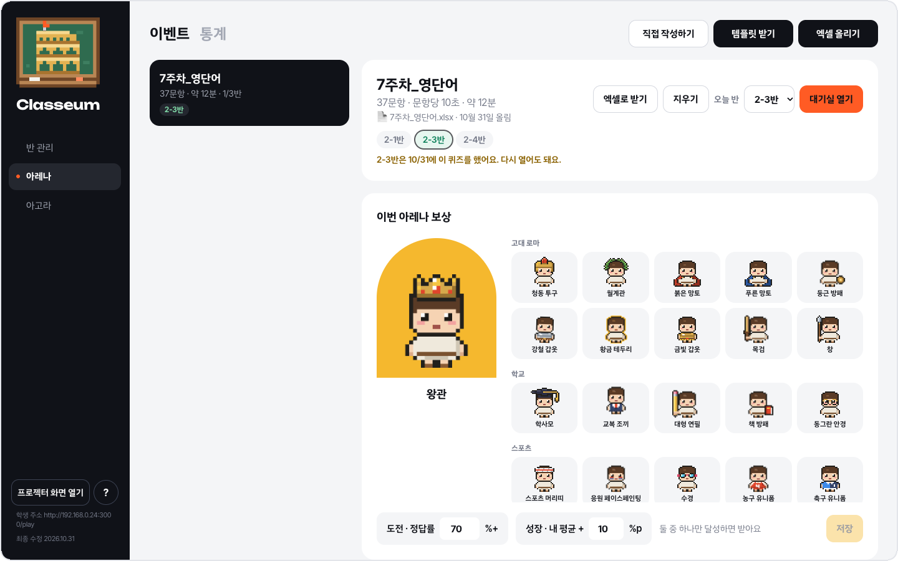
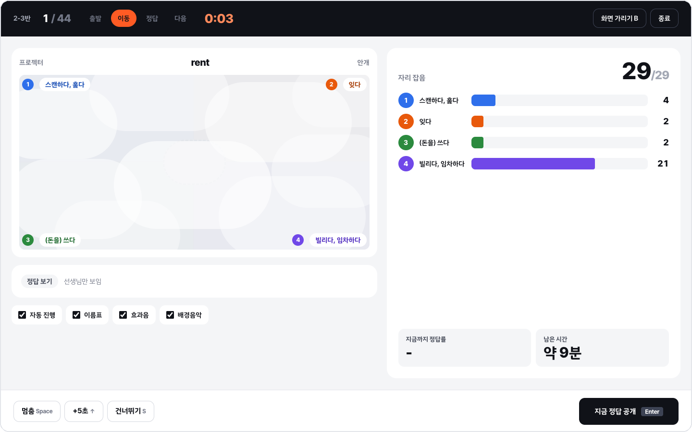
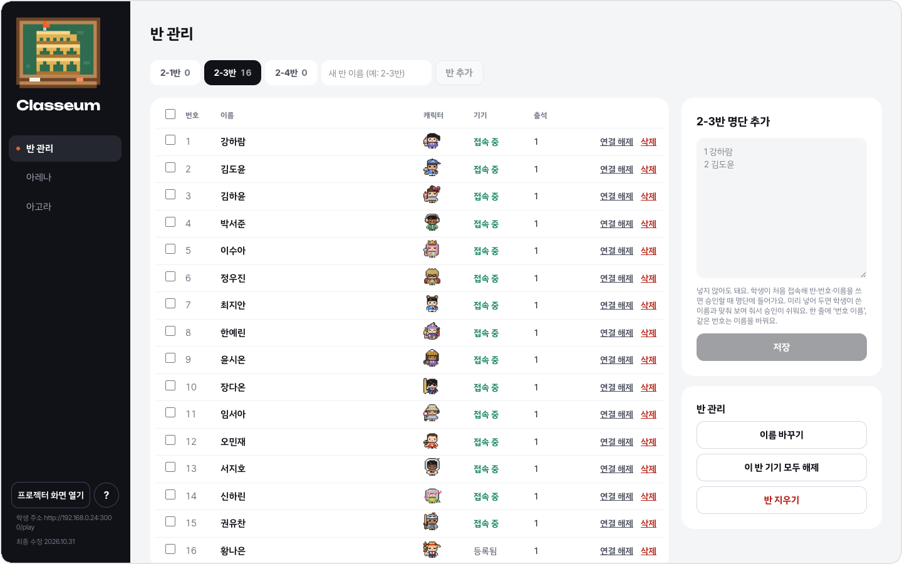
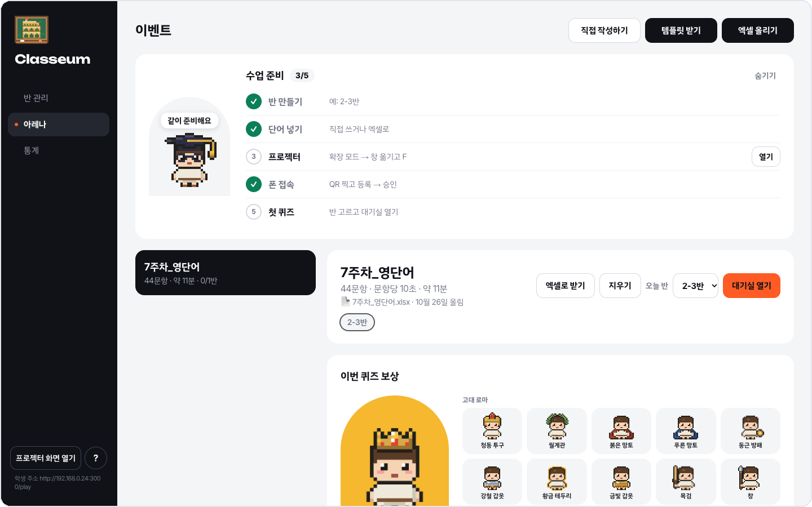
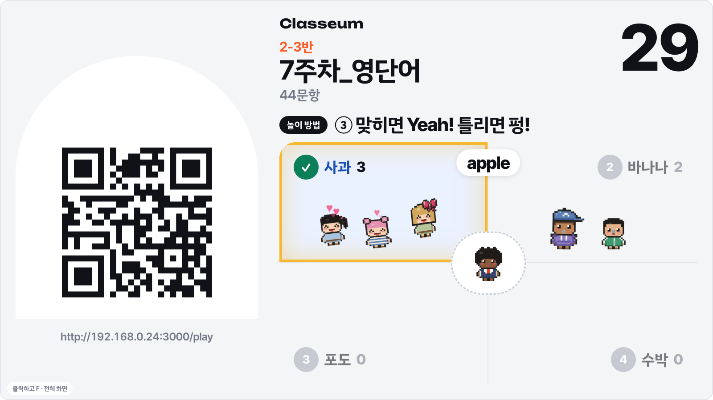

  

<h1 align="center">Classeum</h1>

  <b>교실이 콜로세움이 되는 영단어 퀴즈</b> 
  노트북 한 대, 프로젝터, 학생 폰이면 돼요. 계정도, 앱 설치도 없고, 수업 중에는 인터넷도 필요 없어요.

  

## 이렇게 수업해요

**1. QR로 들어와요.** 학생은 프로젝터의 QR을 찍고 반·번호·이름을 써요. 처음 한 번만 선생님이 승인하면, 다음 주부터는 QR만 찍으면 바로 들어와요. 들어온 친구들은 저마다 고른 캐릭터로 운동장에 모여요.

**2. 안개 속에서 답해요.** 운동장이 네 칸으로 나뉘고, 학생은 폰의 큰 답 칸을 톡 눌러요. 답하는 동안 큰 화면은 안개에 덮여서 누가 어디에 섰는지 보이지 않아요. 따라 하기 없이 각자 생각해요.

**3. 다 같이 공개!** 시간이 끝나면 안개가 걷히고 모두의 자리가 한 번에 보여요. 맞힌 칸의 캐릭터는 하트를 내며 폴짝, 틀린 칸은 "펑!". 맞힌 친구가 있으면 "Yeah!", 아무도 못 맞히면 귀뚜라미 소리가 나요. 점수나 순위는 없어요.

**4. 끝나면 각자 폰에서.** 반 정답률과 오늘의 보상을 받은 친구를 모두 함께 보고, 학생은 폰에서 내 결과와 오답 노트를 보며 틀린 단어를 다시 풀어요.

## 학생 폰

- **내 캐릭터**: 머리 모양 12 · 머리색 7 · 피부 4 · 눈 5가지로 시작하고, 아이템 116개(머리·얼굴·몸·발·손·팔·등·효과)를 모아 꾸며요.
- **크게, 쉽게**: 문제마다 큰 답 칸 네 개. 누르면 내 캐릭터가 그 칸으로 쏙 들어가고, 시간 안에는 바꿀 수 있어요.
- **나만 보는 기록**: 정답 공개 때 맞힌 친구 캐릭터(이름 없이)와 나만 보는 연속 정답이 나와요. 다른 친구와 비교하는 순위는 없어요.
- **모으는 재미**: 오늘의 보상(정답률 70% 넘기 또는 내 평균보다 10%p 오르기)과 출석 발자국 5개마다 주는 선물.

## 선생님 화면

- **단어만 쓰면 문제가 생겨요.** 엑셀 단어장에 단어·뜻만 쓰거나 화면에서 바로 쓰면 뜻 고르기, 단어 고르기, 예문 빈칸 문제와 헷갈리는 오답 보기가 자동으로 만들어져요. 생성형 AI는 쓰지 않아요.
- **진행은 자동, 손은 가볍게.** 모두 답하면 일찍 넘어가고, 멈춤·정답 공개·+5초·건너뛰기는 키 하나로. 정답은 [정답 보기]를 누르기 전까지 가려져 있어요.
- **여러 반을 돌아가며.** 같은 퀴즈를 반마다 열고, 어느 반이 언제 했는지 한눈에 봐요.
- **통계와 엑셀.** 학생별 출석·정답률·자주 틀리는 단어, 단어별 정답률과 가장 많이 고른 오답을 보고 엑셀로 받아요.

  
  

처음 쓰는 노트북에는 **수업 준비** 카드가 반 만들기부터 첫 퀴즈까지 하나씩 안내하고, 대기실의 **[놀이 방법]**을 누르면 프로젝터에 12초짜리 시범이 돌아요.

  
  

## 이런 점이 달라요

- **교실 와이파이에서도 끊기지 않게.** 연결이 소리 없이 끊긴 폰은 스스로 다시 붙고, 폰을 잠근 학생은 조기 마감을 막지 않아요. 같은 화면은 다시 보내지 않아서 폰 40대도 가벼워요.
- **노트북 한 대가 서버.** 바뀐 게 없으면 0.5초 만에 켜지고, 기록은 압축해서 한 학기를 써도 폴더가 크게 늘지 않아요.
- **개인정보는 최소로.** 번호와 이름만 저장하고, 데이터는 그 노트북의 `.data` 폴더에만 있어요. 외부 서버로 보내지 않아요.

---

## 설치 (처음 한 번)

- 이 폴더를 받아요. GitHub 페이지의 [Code → Download ZIP]으로 받아 압축을 풀거나 `git clone https://github.com/kevinkwshin/classeum.git`.
- 폴더는 OneDrive·iCloud로 동기화되는 곳(바탕 화면·문서 폴더인 경우가 많아요) 말고 다른 곳에 두세요. 기록 파일을 문제마다 다시 써서 동기화 앱과 부딪혀요.
- **Mac**: [nodejs.org](https://nodejs.org)에서 **LTS**를 설치하고, 터미널에서 이 폴더로 가서 `npm install`.
- **윈도우**: [nodejs.org](https://nodejs.org)에서 **LTS**를 설치하고(기본값 그대로), 폴더의 **`Classeum.bat`을 더블클릭**하세요. 처음 한 번은 필요한 파일을 받느라 몇 분 걸려요.
- 윈도우에서 처음 켤 때 "Windows 보안 경고 · Node.js" 창이 뜨면 **[허용]**을 누르세요. 학교 와이파이가 '공용 네트워크'로 잡혀 있으면 폰이 못 들어와요. 와이파이 속성에서 '개인 네트워크'로 바꾸거나, 그 창에서 공용 네트워크도 체크하세요.
- 설치하거나 새 ZIP으로 바꾼 뒤 처음 켤 때는 인터넷이 한 번 필요해요(빌드할 때 글꼴을 받아요).

## 수업하기

1. 노트북과 학생 폰을 **같은 와이파이**에 연결해요.
2. 서버를 켜요. Mac은 이 폴더에서 `npm run class`, 윈도우는 `Classeum.bat` 더블클릭. 선생님 화면이 저절로 열려요.
   - 바뀐 게 없으면 빌드를 건너뛰어서 0.5초쯤이면 켜져요. 처음이나 업데이트한 뒤에만 빌드하느라 조금 걸려요.
   - 선생님 화면이 안 열리면 터미널에 나온 선생님 링크를 브라우저에 붙여 넣으세요. 이 링크는 남에게 보여 주지 마세요.
3. 노트북에 프로젝터를 연결하고 화면을 **확장**으로 바꿔요(윈도우 `⊞+P` → 확장, 맥은 시스템 설정 → 디스플레이). 노트북 모니터에는 선생님 화면을 두고, [프로젝터 화면 열기]로 뜬 창은 프로젝터 쪽으로 끌어다 놓은 뒤 `F`로 전체 화면을 만들어요.
4. 처음 쓰는 노트북이면 **수업 준비** 카드가 반 만들기부터 첫 퀴즈까지 하나씩 안내해요. 왼쪽 메뉴 아래 **?**에 도움말이 있어요.
5. 이벤트를 만들어요. [직접 작성하기]로 단어·뜻을 바로 쓰거나, [템플릿 받기]로 받은 엑셀에 단어·뜻을 채워 [엑셀 올리기]. 미리보기를 확인하고 [이벤트 만들기].
   - [엑셀로 받기]는 이벤트의 단어를 템플릿 모양 엑셀로 내려받아요. 직접 작성 창과 이벤트 상세에 있어요.
6. 보상 아이템과 **오늘 반**을 고르고 [대기실 열기]. [놀이 방법]을 누르면 프로젝터에 12초짜리 시범이 나와요.
7. 학생은 큰 화면의 QR을 찍고 반·번호·이름을 써요. 선생님 화면 오른쪽에 등록 요청이 뜨면 학생 폰의 확인 기호와 같은지 보고 승인하세요. 다음 주부터는 QR만 찍으면 바로 들어와요.
8. [퀴즈 시작]. 끝나면 [아레나 닫기]로 모든 폰을 대기 화면으로 돌려보내요.
   - 문제마다 마지막 3초에 나무 블록 "똑·딱" 소리가 나요. 정답 공개 때 맞힌 학생이 있으면 "Yeah!" 소리가, 아무도 못 맞히면 귀뚜라미 소리가 나요. 대기실과 결과 화면에서는 신나는 배경음악이 작게 흘러요(문제 풀 때는 멈춰요). 프로젝터 창을 **한 번 클릭하거나 F를 누르면** 프로젝터에서 나고(그때 한 번 들려줘요), 그 전에는 선생님 화면에서 나요. 끄려면 [효과음]·[배경음악] 체크를 푸세요.
9. 끌 때는 터미널 창을 닫으세요(윈도우는 Classeum.bat이 연 검은 창). 닫을 때 기록이 저장돼요.

## 단축키

퀴즈 중에 선생님 화면과 프로젝터 화면 어디서 눌러도 돼요. 한글 입력 상태에서도 그대로 먹어요.

| 키 | 동작 |
|---|---|
| Space | 멈춤 / 다시 시작 |
| Enter | 지금 정답 공개 |
| ↑ | +5초 |
| → | 다음 |
| S | 건너뛰기 |
| B | 화면 가리기 (시계도 멈춤) |
| F | 전체 화면 (프로젝터 화면) |

## 접속이 안 될 때

- 학교 와이파이는 기기끼리 통신을 막는 경우가 많아요. 그럴 땐 **40대 이상 받는 휴대용 공유기**에 노트북과 학생 폰을 모두 연결하세요. 휴대폰 핫스팟은 보통 10대 안팎이라 반 전체를 받지 못해요.
- 방화벽이 막고 있지 않은지 확인하세요. 윈도우는 위의 [허용]과 개인 네트워크, Mac은 시스템 설정 → 네트워크 → 방화벽.
- 공유기에서 노트북 IP를 고정(예약)해 두세요. 주소가 바뀌면 학생 폰이 새 기기로 보여서 다시 등록해야 해요.
- 노트북 절전·화면 보호기를 끄고 전원을 연결해 두세요.

## 데이터

- 기록은 이 노트북의 `.data` 폴더에만 있고 git에 올라가지 않아요. 노트북을 바꾸면 `.data` 폴더를 통째로 옮기세요.
- 학생 정보는 번호, 이름, 퀴즈 기록, 캐릭터만 저장해요.
- 기록 파일(`.data/classeum.json`)이 망가져 있으면 덮어쓰지 않고 서버를 켜지 않아요. 망가진 파일은 `classeum.json.broken-…`으로 남겨요.
- `.data/teacher-key`는 선생님 링크의 열쇠예요. 링크가 퍼졌다면 이 파일을 지우고 서버를 다시 켜세요. 새 열쇠가 생기고 예전 링크는 더 이상 통하지 않아요.
- [통계]의 [이 반 엑셀로]·[전체 엑셀로]로 학생별 기록을 받을 수 있어요.

## 업데이트

- git으로 받았다면 그 폴더에서 `git pull`.
- 새 ZIP으로 받았다면 압축을 푼 새 폴더에 **예전 폴더의 `.data` 폴더를 통째로 복사**하세요. Mac Finder에서는 `.data`가 숨겨져 있어서 `Cmd+Shift+.`을 눌러야 보여요.
- 업데이트한 뒤 처음 켤 때는 빌드하느라 조금 걸려요. 필요한 파일이 바뀌었으면 터미널이 `npm install`을 하라고 알려 줘요.

---

스크린샷의 학생 이름은 모두 가짜예요. · 기획서: [docs/PLAN.md](docs/PLAN.md) · 소리 출처: [public/sounds/CREDITS.txt](public/sounds/CREDITS.txt)
